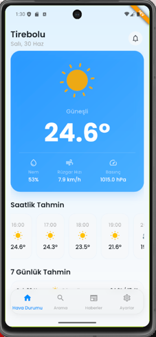
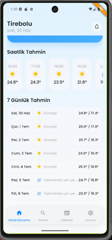
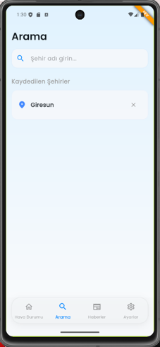
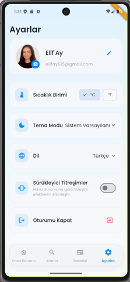

# Weathernaut 🌦️

Weathernaut, modern tasarımı ve gelişmiş özellikleri ile kullanıcılara anlık hava durumu güncellemeleri, saatlik/haftalık tahminler ve hava durumu haberleri sunan premium bir Flutter mobil uygulamasıdır.

---

## Ekran Görüntüleri / Screenshots

| Ana Ekran (Hava Durumu) | 7 Günlük Tahmin | Şehir Arama |
|:---:|:---:|:---:|
|  |  |  |

| Haberler (News) | Ayarlar (Settings) |
|:---:|:---:|
|  |  |

---

## Özellikler / Features

* **Anlık Hava Durumu Detayları:** Sıcaklık, nem oranı, rüzgar hızı, basınç ve güncel hava durumu animasyonları.
* **Saatlik ve 7 Günlük Tahminler:** Önümüzdeki saatlerin ve günlerin hava durumu beklentilerini listeleyen detaylı grafikler.
* **Akıllı Şehir Arama:** Dünyadaki tüm şehirleri arama ve son aranan şehirleri hızlı erişim için önbelleğe alma (Hive).
* **Haber Kaynağı (News Feed):** En son hava durumu gelişmelerini ve güncel haberleri takip edebileceğiniz özel bir haber sekmesi.
* **Dinamik Tema Desteği:** Sistem varsayılanlarına duyarlı, göz yormayan Karanlık Mod (Dark Mode) ve Aydınlık Mod (Light Mode) entegrasyonu.
* **Çoklu Dil Desteği:** `slang` kütüphanesi kullanılarak hazırlanmış eksiksiz Türkçe ve İngilizce dil seçenekleri.
* **Sürükleyici Titreşimler:** Hava durumu durumuna (yağmur, fırtına vb.) göre tetiklenen özel dokunsal (haptic) geri bildirimler.
* **Güvenli Oturum:** Firebase Auth ile giriş yapma, kayıt olma ve kullanıcı profili yönetimi.

---

## Kullanılan Teknolojiler / Tech Stack

* **Core:** Flutter (Dart)
* **State Management:** `flutter_bloc`
* **Local Storage:** `hive` (Önbellekleme, ayarlar ve şehir geçmişi için)
* **Animations:** `lottie` (Premium hava durumu animasyonları)
* **Backend:** `firebase_core`, `firebase_auth`, `cloud_firestore`
* **Localization:** `slang`
* **Navigation:** `auto_route`

---

## Kurulum ve Çalıştırma / Getting Started

### Bağımlılıkları Yükleme
Projenin kök dizininde terminali açıp aşağıdaki komutu çalıştırın:
```bash
flutter pub get
```

### Uygulamayı Çalıştırma (Geliştirici Ortamı)
Geliştirici (DEV) ortamında çalıştırmak için:
```bash
flutter run -t lib/flavors/main_dev.dart
```

### Uygulamayı Çalıştırma (Canlı Ortam)
Canlı (PROD) ortamda çalıştırmak için:
```bash
flutter run -t lib/flavors/main_prod.dart
```
